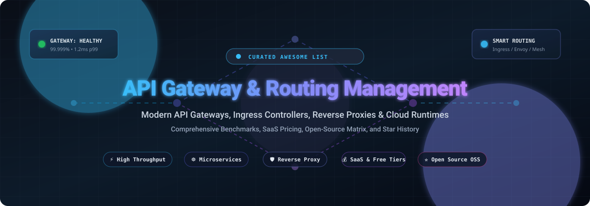

  

  
  
  
  
  
  

  <b>A curated catalog of the world's best API Gateway, API Management, Ingress Controller, Reverse Proxy, and Traffic Routing solutions for cloud-native microservices, serverless, and enterprise architectures.</b>

---

## 📑 Table of Contents

- [🌐 Sector Overview & Market Dynamics](#-sector-overview--market-dynamics)
- [💼 SaaS & Managed API Gateway Solutions](#-saas--managed-api-gateway-solutions)
- [🚀 Top Open-Source API Gateways & Runtimes](#-top-open-source-api-gateways--runtimes)
- [🔍 Key Evaluation Criteria](#-key-evaluation-criteria)
- [📈 Star History](#-star-history)
- [💖 Support & Contributing](#-support--contributing)
- [📜 License](#-license)

---

## 🌐 Sector Overview & Market Dynamics

The global API Management and Gateway market is estimated at approximately **$5.6B to $7.7B** in 2024–2025 (scaling toward **$9.6B+** at an annual CAGR of 15–25%), accelerated by the rapid proliferation of microservices, distributed cloud environments, and high-volume AI model proxying. The industry demonstrates **medium-to-high fragmentation** rather than a winner-take-all monopoly: while hyperscale cloud platforms (Microsoft Azure, Google Cloud, AWS) dominate enterprise infrastructure bundling, specialized open-core innovators (Kong, Tyk, Traefik Labs) and open-source runtimes (Caddy, Envoy, Apache APISIX) command massive developer mindshare across hybrid and multi-cloud footprints.

---

## 💼 SaaS & Managed API Gateway Solutions

A comparative breakdown of enterprise SaaS and fully managed API gateway services, sorted in descending order by parent company size (valuation / market capitalization):

| Product | Provider | Company Valuation / Revenue | Starting Pricing Tier | Free Tier Limits / Free Trial |
| :--- | :--- | :--- | :--- | :--- |
| **Azure API Management** ☁️ | Microsoft | ~$3.94T Market Cap (FY24 Rev: $245B) | **$3.50 per 1M calls** (Consumption tier overage after free allotment) / **$48.04/month** (Developer Tier for non-production) | **1,000,000 API calls free per month** (forever on Consumption tier; capped at 3,000 operations and 100 products) |
| **Apigee API Management** 🌐 | Google Cloud (Alphabet) | ~$3.33T Market Cap (FY24 Rev: $350B) | **$0.50/hour per region** (~$365/month Base Environment) + **$20 per 1M standard calls** (Pay-as-you-go) | **60-day free evaluation** (Evaluation organization sandbox with full enterprise proxy features; auto-expires after 60 days) |
| **Amazon API Gateway** ⚡ | Amazon Web Services (Amazon) | ~$2.81T Market Cap (FY24 Rev: $638B) | **$1.00 per 1M requests** (HTTP APIs up to 300M requests/mo) / **$3.50 per 1M requests** (REST APIs) | **1,000,000 API calls free per month for 12 months** (AWS Free Tier: 1M HTTP/REST calls + 1M WebSocket messages & 750k connection mins/mo) |
| **MuleSoft Anypoint Platform** 🔗 | Salesforce | ~$180B Market Cap (FY25 Rev: $41.5B) | **~$2,000/month** ($24,000/year annual contract for Anypoint Integration Starter tier) | **30-day free trial** (Hosted sandbox environment for API Designer & Code Builder; strictly non-production and resource-capped) |
| **NGINX Plus / F5 Distributed Cloud** 🛡️ | F5, Inc. | ~$20B Market Cap (FY24 Rev: $3.4B) | **$6,468.99/instance/year** (CDW / NGINX Plus subscription license + standard support) | **30-day free trial** (Full NGINX Plus software package with dynamic reconfiguration and active health checks; non-production) |
| **Kong Konnect** 🦍 | Kong Inc. | $2.0B Valuation ($175M Series E) | **$25/month** (Konnect Plus Serverless Control Plane base tier; includes 1M requests/mo, additional calls metered) | **30-day free trial** (Full enterprise Konnect Plus features, unlimited trial gateways, and 30-day analytics retention) |
| **Tyk Cloud** 🚀 | Tyk Technologies | ~$140M Valuation ($41M+ raised) | **~$600/month** (Tyk Cloud Starter tier for managed control plane & multi-data planes) | **48-hour free trial** (Full platform access including dashboard, developer portal, and governance tools with no traffic limits) |
| **Traefik Hub** 🎛️ | Traefik Labs | ~$50M Valuation ($11M+ raised) | Commercial quote-based starting at **~$99/month** (Team/Pro tiers for API Gateway & management) | **14-day free trial** (Full Traefik Hub feature access with no request/cluster caps; no credit card required) |

---

## 🚀 Top Open-Source API Gateways & Runtimes

Explore top-rated, open-source API gateways, reverse proxies, and Kubernetes ingress controllers. Repositories are sorted in descending order by GitHub star count:

| Project & Repo | Stars | License | Primary Language / Architecture | Key Highlights |
| :--- | :---: | :--- | :--- | :--- |
| **[Caddy](https://github.com/caddyserver/caddy)** |  | Apache-2.0 | Go | Powerful enterprise-ready HTTP/2 & HTTP/3 web server with automatic HTTPS via Let's Encrypt / ZeroSSL, reverse proxying, and dynamic JSON API configuration. |
| **[Traefik Proxy](https://github.com/traefik/traefik)** |  | MIT | Go | Leading cloud-native HTTP reverse proxy and ingress controller with automatic discovery for Docker, Swarm, Kubernetes, and automatic TLS termination. |
| **[Kong Gateway (OSS)](https://github.com/Kong/kong)** |  | Apache-2.0 | Lua / OpenResty (NGINX) | The world's most adopted cloud-native API gateway; supports declarative DB-less mode, hybrid deployment, and a rich plugin ecosystem (rate limiting, auth, caching). |
| **[Envoy Proxy](https://github.com/envoyproxy/envoy)** |  | Apache-2.0 | C++ | High-performance C++ distributed service and edge proxy originally developed by Lyft; standard data plane for modern service meshes (Istio, Cilium) and gateways. |
| **[Cilium Service Mesh / Ingress](https://github.com/cilium/cilium)** |  | Apache-2.0 | Go / eBPF / C | eBPF-powered networking, observability, and security with built-in high-performance L7 API routing, Gateway API support, and ingress proxying. |
| **[Apache APISIX](https://github.com/apache/apisix)** |  | Apache-2.0 | Lua / NGINX / etcd | Ultra-high performance, dynamic API gateway with hot-reloading via etcd, multi-language plugin runtimes (Go, Java, Python, Wasm), and native dashboard. |
| **[Netflix Zuul](https://github.com/Netflix/zuul)** |  | Apache-2.0 | Java / Netty | Battle-tested edge gateway service by Netflix providing dynamic routing, monitoring, resiliency, and security filters on top of non-blocking Netty. |
| **[Tyk Gateway (OSS)](https://github.com/TykTechnologies/tyk)** |  | MPL-2.0 | Go | Fast, lightweight Go-based API gateway with zero third-party dependencies; supports GraphQL routing, mutual TLS, rate limiting, and gRPC endpoints. |
| **[Lura Project / KrakenD](https://github.com/luraproject/lura)** |  | Apache-2.0 | Go | Ultra-fast stateless Go framework powering KrakenD; capable of aggregating multiple backends, transforming data, and handling 100k+ req/sec on modest hardware. |
| **[Spring Cloud Gateway](https://github.com/spring-cloud/spring-cloud-gateway)** |  | Apache-2.0 | Java / Spring Boot | Built on Project Reactor and Spring WebFlux; provides programmatic route matching, non-blocking asynchronous processing, and Spring Cloud integration. |
| **[Emissary-Ingress (Ambassador)](https://github.com/emissary-ingress/emissary)** |  | Apache-2.0 | Python / Go (Envoy) | CNCF incubating Kubernetes-native API gateway and ingress controller built on Envoy Proxy; specializes in developer self-service and Canary releases. |
| **[Envoy Gateway](https://github.com/envoyproxy/gateway)** |  | Apache-2.0 | Go (Envoy data-plane) | The official CNCF Kubernetes Gateway API implementation for Envoy; simplifies declarative management of traffic, security policies, and rate limits. |
| **[KrakenD CE](https://github.com/krakend/krakend-ce)** |  | Apache-2.0 | Go | The community edition of KrakenD; true linear scalability, zero state, and comprehensive middleware out of the box. |

---

## 🔍 Key Evaluation Criteria

When selecting an API Gateway or Reverse Proxy for your infrastructure, consider:

- ⚡ **Throughput & Latency (p95/p99)**: Does the proxy introduce non-negligible millisecond overhead under high concurrency?
- 🔄 **Dynamic Reconfiguration**: Can routes, plugins, and upstreams be updated at runtime without dropping traffic or restarting workers?
- ☸️ **Kubernetes & Cloud-Native Alignment**: Is there native support for the Kubernetes Gateway API and Ingress specifications?
- 🔐 **Security & Protocols**: Comprehensive support for mTLS, OAuth 2.0, OpenID Connect, JWT validation, rate limiting, and Web Application Firewalls (WAF).
- 🧩 **Extensibility**: Support for custom plugins in familiar languages (Go, Lua, Python, Java) or via WebAssembly (Wasm) filters.

---

## 📈 Star History

---

## 💖 Support & Contributing

Contributions, feature suggestions, and updates are warmly welcomed! 

- ⭐ **Star this repository**: If you found this list helpful, please give it a star on GitHub!
- 🍴 **Fork & Share**: Help fellow engineers discover and choose the right gateway architectures.
- ☕ **Buy Me a Coffee**: If you'd like to support ongoing maintenance and research, visit the [GitHub Sponsors Dashboard](https://github.com/sponsors/ishandutta2007).

Thank you for supporting open-source software and the developer community! 🙌

---

## 📜 License

Distributed under the MIT License. See [LICENSE](LICENSE) for more information.
